# R3BL Task Management

[](https://open-vsx.org/extension/R3BL/r3bl-task-management)
[](https://marketplace.visualstudio.com/items?itemName=R3BL.r3bl-task-management)

Manage task spaces—collections of open tabs, an explicit Task Stack, and Jump Point
Navigation (captures your path through the code) within a single git branch. Leverage "The
Dashboard Workflow" to unleash your creativity and invent!

## The Dashboard Workflow - Designed for Humans & Fit for Purpose

This extension implements the **Dashboard Workflow** (created by
[Nazmul Idris](https://nazmulidris.com)) - a fluid, non-linear task management methodology
designed for individual developer productivity with or without Coding Agents.

It provides an alternative to traditional, rigid frameworks like Scrum, Agile, or
ticket/issue based systems, and really prioritizes fluidity over rigidity. The mantra is
"start with anything on a blank page", then refine over time.

Invention, creativity, and programming are not linear - projects take many twists and
turns, detours and story arcs. You will learn more about the problem surface as you take
your first steps - for non-trivial problems this can't be known beforehand. This
methodology is designed to work with this non-linearity rather than against it.

It incorporates the use of tooling to help you (and not replace you) by optimizing and
automating this workflow. The tooling removes as much cognitive load as possible, and
manual / menial labor as possible, and gives you the richest context possible, as you move
around rapidly, liberating you from "keeping it all in your head". You do what you are
good at. Let your machine buddies augment you with what they are good at.

### Core Principles:

1. **1:1 Mapping:** Every task is represented by a single Markdown file (`.md`) in the
   `task/` directory. The `.md` file _is_ the task. This Markdown file is either generated
   by a person using a Coding Agent, or manually - it doesn't matter. The goal of the task
   file is to capture the high level objectives around the body of work. It can be as
   detailed or sparse as you like.
2. **Spatial Context Preservation:** Every task space preserves your **spatial context**
   in the codebase across two dimensions:
    - **Opened Tabs (Breadth):** The exact files open in your editor, their tab order,
      active tab, and pinned state.
    - **Jump Point Navigation (Depth):** The ordered sequence of symbol definitions
      (`Alt+U` / `Alt+Shift+U`) you navigated through while exploring or implementing the
      task.
3. **Fluid Routing:** Tasks move dynamically across explicit states:
    - **Active Task (HEAD):** The single task currently focused in a specific IDE instance
      (per-IDE in `workspaceState`).
    - **Task Stack (`Active` or `Parked`):** An explicit workspace-wide LIFO call stack
      (`taskSpaceStackIds` in `.vscode/task-spaces.json`, ordered bottom → head) governed
      by a pure typestate control plane (`empty` | `on-stack` | `browsing-stack` |
      `parked`). Pushing a task adds it as the stack `[HEAD]`; flat-switching (`Enter`)
      never pops or mutates the stack—clicking a paused caller lets you browse that stack
      frame freely, while switching to an unrelated task **parks** the stack with its
      `[Head]` preserved so you can resume right where you left off with `Alt+Shift+J` (or
      `Enter` on `[Head]`), without off-stack tasks hijacking stacked callers.
    - **Available Task Spaces:** All active workspace tasks sorted by per-IDE
      `lastAccessed` time—selecting one performs a clean **Flat Switch** (`Enter`) without
      pushing onto the Task Stack.
    - **Backlog:** Tasks moved to `task/pending/` are out of the immediate workflow
      pipeline.
    - **Done:** Finished tasks are archived to `task/done/` (and their saved jump points
      are automatically pruned).
4. **Auto-Pickup:** Creating a new `.md` file in the `task/` directory automatically
   creates a task space for it and makes it available in **Available Task Spaces**.

### How it differs from Scrum, Agile, and Ticket Systems:

- **Non-Linear vs. Linear:** Traditional systems often force a linear "Sprints" or "Ready
  -> Doing -> Done" progression. The Dashboard Workflow recognizes that development is
  rarely linear. It allows you to "pivot on a dime", shifting context as discovery happens
  without the friction of updating a project management board.
- **Opportunistic vs. Planned:** Encourages "fixing things when you see them". If you spot
  a bug or refactoring opportunity while 6 definitions deep in Task A, use **Push New
  Subtask** to push Task A onto the **Task Stack** and start the detour clean (no
  inherited tabs or jump points), then **Pop** (`Alt+Shift+J`) or **Finish**
  (`Alt+Shift+F`) right back into Task A's intact tabs and definition trail when done. Or
  drop a `.md` file in `task/` for later pickup from Available Task Spaces.
- **Fluid Scoping:** Use Task Spaces to spin off subtasks into their own spaces, each with
  its own isolated spatial context (opened tabs + Jump Point Navigation), keeping mental
  overhead low.
- **Retain knowledge:** If you ever want to look back in time and understand the "why"
  behind a particular chunk of work, you can always look in your `task/done` folder and do
  a retrospective. It can also be valuable context, that you don't have to fit in your
  head, as you evolve something over a long period of time, that starts out simple, and
  evolves into complexity. This knowledge is in your git repo in a Markdown file! You
  don't have to look at in an external tool / project management board to get it! You have
  it, your team has it, and your Coding Agents have it.
- **Coding Agent Synergy:** Coding Agents can autonomously drop a task file into the
  `task/` folder, and it instantly appears in **Available Task Spaces** in your dashboard,
  ready for human review or joint implementation. And of course, as you explore your
  codebase with them, all the history in `task/done/`, and the info in `task/` will help
  guide them too in their predictions and pattern matching (if you are using LLM based
  agents).

## Use Cases

### Spatial Context Preservation (Opened Tabs + Jump Point Navigation)

Each task space saves two things when you switch away from it, so you never lose your
spatial context in a task:

- Which files were open, their tab order, active tab, and pinned state.
- Your **Jump Point Navigation** trail (`Alt+U` / `Alt+Shift+U`)—the sequence of symbol
  definitions you jumped through while working on that task.

When you switch back to a task with **Alt+Shift+T**, its opened tabs and jump points are
restored where you left them.

### Deep Code Exploration & Opportunistic Detours (Task Stack)

While tracing a complex call chain (`fn handle_request → Service::call → Pool::acquire`)
with **Alt+U**, you spot an unrelated bug in `Pool::acquire`:

1. Press **Alt+Shift+T** → **Push New Subtask** (`fix-pool-leak`).
2. Your parent task is pushed onto the **Task Stack**, and the subtask starts completely
   clean—only `task/fix-pool-leak.md` open, with empty Jump Point Navigation so your bug
   investigation (`Alt+U`) never pollutes the parent trail.
3. Press **Alt+Shift+F** (Finish) or **Alt+Shift+J** (Pop) when done—you land right back
   in your parent task with its original tabs and `handle_request → Service → Pool` jump
   points intact.

### Coding Agent Collaboration

Run multiple Coding Agent instances in parallel (e.g., Claude Code, Gemini CLI in
different terminal tabs or tmux panes), each working on different aspects of your work.
Create task spaces for each to organize files, trace agent changes with `Alt+U`, export
jump points to `.code-search` tabs for review or prompt context, and switch contexts
seamlessly.

Attach a `task/*.md` file (that the Coding Agent manages, with the `/r3bl-task` custom
command for Claude Code, Gemini CLI, etc.) to each space to track design and
implementation plans, and have completed tasks automatically archived to `task/done/` when
they're finished.

### Multiple Concurrent Workflows (Same Branch)

Working on a feature but need to quickly review a PR? Or switch between implementation and
research? Create separate task spaces for each workflow **on your current branch**:

- **"Feature: Auth"** - Implementation files (`src/auth.ts`, `src/login.ts`) + auth call
  trail
- **"Research: OAuth"** - Documentation tabs, examples, and spec exploration trail
- **"Code Review: PR #123"** - Changed files + review jump trail
- **"Bug Fix: Login Error"** - Debugging context pushed onto the Task Stack

### Multi-IDE Workflows (Different Task Spaces Per IDE)

**The problem:** VS Code only allows one window per project folder. You can't open the
same project twice in VS Code.

**The solution:** Use multiple IDEs! Open the same project folder in VS Code, VS Code
Insiders, VSCodium, and/or Antigravity IDE simultaneously - each with a **different task
space active**:

- **VS Code**: "Feature: Auth" task space with implementation files
- **VS Code Insiders**: "Research: OAuth" task space with documentation tabs
- **Antigravity IDE**: "Code Review: PR #123" task space with changed files

Each IDE maintains its own active task space independently. Task space definitions, the
workspace Task Stack (`task-spaces.json`), and per-task Jump Point Navigation
(`jump-points.json`) sync live across all IDEs, while which space is "active" is stored
per-IDE instance.

This enables workflows like:

- **Parallel development**: Implementation in VS Code, research in Insiders, review in
  Antigravity IDE or VSCodium
- **Side-by-side comparison**: Compare different task space configurations across IDEs
- **Testing + Development**: Test extensions in Insiders while working in stable VS Code
- **Multiple Coding Agent sessions**: Different agent instances working on different task
  spaces

**How it works:** When you switch task spaces in VS Code, VS Code Insiders' active space
stays unchanged. But if you add/remove tabs or record jump points (`Alt+U`) in "Feature:
Auth" in VS Code, those changes sync live to Insiders if it also has "Feature: Auth"
active.

## What It Does

- **Task Dashboard**: A central dialog (`Alt+Shift+T`) showing quick Actions, your Active
  Task / Task Stack, and Available Task Spaces.
- **1:1 Mapping**: Every task space is tied to a real `.md` file in your `task/` folder.
- **Auto-Pickup**: New `.md` files in `task/` are automatically registered in **Available
  Task Spaces**.
- **Flat Switch vs. Explicit Call Stack**: Press `Enter` in `Alt+Shift+T` for a
  non-destructive flat switch (including browsing lower stack frames without popping!), or
  explicitly **Push** / **Push New Subtask** and **Pop** (`Alt+Shift+J`) like a call
  stack.
- **Per-Task Jump Point Navigation**: Record definition jumps (`Alt+U`), backtrack or
  forward-track in the Jump Point Navigation popup (`Alt+Shift+U`), and export jump points
  to `.code-search`—strictly isolated per task space.
- **Tab State Preservation**: Remembers tab order and pinned state across switches and
  restarts.
- **Diff-Based Sync**: Only applies minimal changes (close/open/move/pin) for smooth
  transitions.
- **Multi-IDE Support**: Different IDEs (VS Code, Insiders, VSCodium, Antigravity IDE) can
  have different task spaces active on the same project folder while sharing the workspace
  Task Stack and per-task Jump Point Navigation.
- **Cross-IDE Sync**: Tab changes, Task Stack, and per-task Jump Points sync across IDEs.
- **Smart Startup**: Skips restore if current tabs already match saved state.
- **Coding Agent Integration**: Link task spaces to `task/*.md` files for tracking
  implementation plans.
- **Automatic Archival**: Completed task files move to `task/done/` automatically and
  prune their task-scoped jump points.
- **Status Bar**: See your active task space, stack depth (`[stack: N]`), browsed frame
  (`[in stack · head: <Head>]`), or parked stack (`[parked: <Head>]`) at a glance.
- **Auto-Save**: Current tabs are saved automatically when you switch or modify.
- **Smart Collision Handling**: No data loss - files get numeric suffixes if duplicates
  exist (when archiving tasks).

## Getting Started

### Requirements

- VS Code 1.70.0 or higher
- No external dependencies

### Quick Start

**Press Alt+Shift+T** to open the Task Dashboard.

1. **Create a task or push a clean subtask:**
    - **Create New Task Space**: Names a new task (linking or creating `task/<name>.md`),
      **clones your currently open tabs**, and flat-switches to it without modifying the
      Task Stack.
    - **Push New Subtask**: Explicitly pushes your current active task onto the **Task
      Stack**, closes parent tabs, and starts **clean** with only the subtask's
      `task/<name>.md` and an empty Jump Point trail.

2. **Flat Switch vs. Explicit Stack Push / Pop:**
    - **Flat Switch (`Enter` in `Alt+Shift+T`)**: Saves current tabs and switches cleanly
      to the selected task without pushing onto or popping the Task Stack. Switching to a
      paused caller lets you browse stack frames non-destructively (keeping `[Head]`
      intact); switching to an off-stack task **parks** the stack with its `[Head]`
      preserved (and selecting `[Head]` later resumes it).
    - **Push onto Stack**: Click `[Push onto Stack]` on any Available Task Space (or run
      `Task Management: Push Task onto Stack...`) from anywhere (empty, on-stack,
      browsing, or off-stack) to push onto the Task Stack.
    - **Pop / Resume Stack (`Alt+Shift+J` or top row)**: When **on-stack**, pauses the
      head task and pops back to its parent; when **browsing** a lower frame or
      **off-stack** with a parked stack, saves the current task and jumps straight back to
      `[Head]` without popping its callers.

3. **Jump Point Navigation (`Alt+U` / `Alt+Shift+U`):**
    - Place your cursor on any symbol and press **Alt+U** to record a jump point (for the
      active task space) and jump to its definition.
    - Press **Alt+Shift+U** anytime to open that task's **Jump Point Navigation**
      popup—backtrack with `Up` + `Enter`, forward-track with `Down` + `Enter`, remove
      individual stops, or dump all jump points with surrounding code context into a
      `.code-search` tab.

4. **Finish Task:**
    - Press **Alt+Shift+F** or select "Finish Current Task" in the Dashboard.
    - Your `.md` file moves to `task/done/` and the task's jump points are pruned.
    - If the **Task Stack** has a caller task waiting, you automatically pop back to it;
      if the stack is empty, all open tabs close to `No Task Space` so you can pick the
      next task explicitly.

5. **Manage spaces:**
    - Click ✏️ to rename
    - Click 🗑️ to delete (archives linked files to `task/done/` and prunes jump points)

## Screenshots

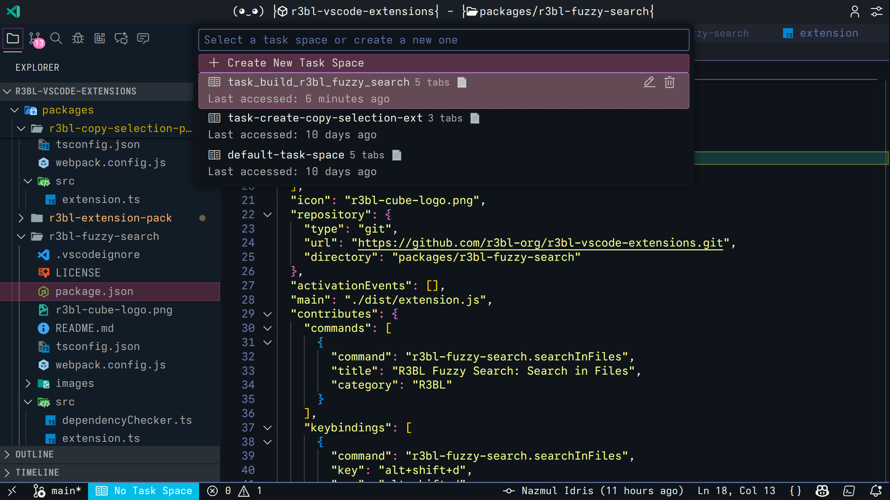
_Main dialog showing all your task spaces_

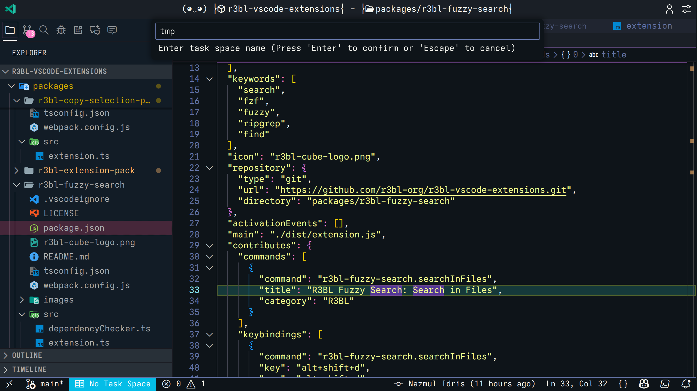
_Create a new workflow context_

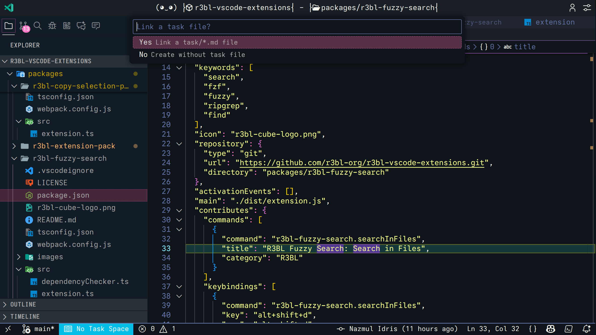
_Link to Coding Agent task files_

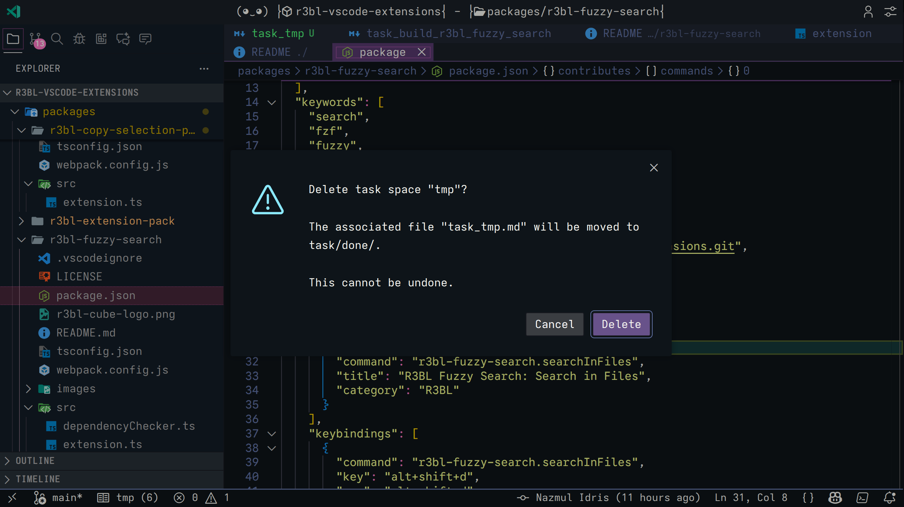
_Automatic archival to task/done/_

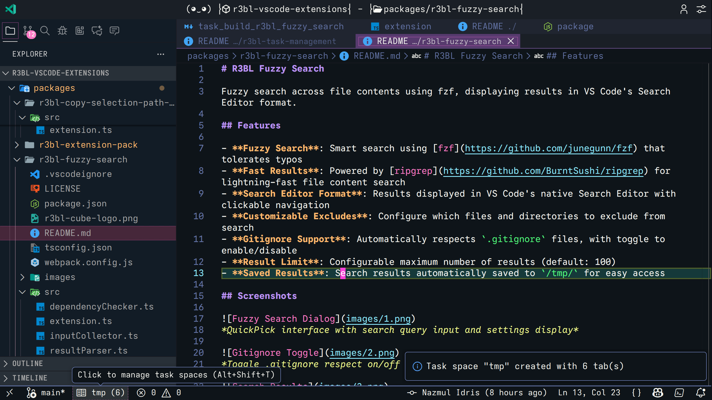
_Status bar shows active context_

## Jump Point Navigation

When exploring a codebase, you often drill down into a function, method, or type using "Go
to Definition", then from that definition drill down into another type or function, and so
forth. **Jump Point Navigation** records your exploration path as an ordered stack of jump
points scoped to your active task space—so you can backtrack to earlier steps,
forward-track again, switch tasks without losing your trail, or dump all jump points into
a `.code-search` editor tab.

### Keybindings

| Keybinding    | Command                                          | Description                                                       |
| :------------ | :----------------------------------------------- | :---------------------------------------------------------------- |
| `Alt+U`       | `R3BL: Jump to Definition and Record Jump Point` | Record jump point and jump to definition                          |
| `Alt+Shift+U` | `R3BL: Show Jump Points`                         | Open the Jump Point Navigation popup to navigate or manage points |

These shortcuts work across **all languages** (Rust, TypeScript, Markdown, etc.) whenever
a definition provider is available.

### How It Works

1. **Automatic Origin Capture**: On your very first `Alt+U` jump (or when jumping from a
   new file that isn't part of your current stop), the extension records **both** where
   you jumped _from_ (`#1`) and the definition you landed _on_ (`#2`). This ensures you
   can always backtrack all the way to your starting call site.
2. **Seamless Drill-Down**: When you are inside the file you just jumped to and press
   `Alt+U` on a field, parameter, or function call to drill deeper, only the new
   destination is appended to the bottom of the stack (`#3`, `#4`, etc.).
3. **Per-Task Scoping & Cross-IDE Persistence (`.vscode/jump-points.json` v3.0)**: Jump
   points and `currentIndex` are stored per `taskSpaceId` in `.vscode/jump-points.json`
   (`"version": "3.0"`, with `workspaceState` fallback when no folder is open), and synced
   live across open IDEs (VS Code, Antigravity IDE, etc.) via a `FileSystemWatcher` and
   SHA-256 checksum deduplication:
    - **Clean Swaps on Task Changes**: Switching, pushing, or popping task spaces swaps
      the active task's jump points cleanly with zero cross-task overlap.
    - **Active Task Required**: Pressing `Alt+U` or `Alt+Shift+U` when `No Task Space` is
      active shows a status bar warning prompting you to pick or create a task
      (`Alt+Shift+T`).
    - **Automatic Pruning on Finish/Delete**: Finishing (`Alt+Shift+F`) or deleting a task
      space automatically prunes that task's saved jump points (use `.code-search` export
      beforehand if you want to archive a snapshot of the exploration trail).

### Jump Point Navigation Popup (`Alt+Shift+U`)

Pressing `Alt+Shift+U` opens an interactive popup listing your recorded jump points from
first jump (`1.`) at the top to most recent jump at the bottom:

- **`→` ("You Are Here" Marker)**: Highlights the step you are currently visiting and
  automatically pre-selects that row so pressing `Up` + `Enter` immediately backtracks,
  and `Down` + `Enter` forward-tracks.
- **`[🗑️]` Remove Jump Point**: Click the trash icon on any row to remove that single stop
  in-place without closing the popup.
- **🔍 Open Jump Points in Search Editor (`.code-search`)**: Writes all recorded jump
  points—along with surrounding context lines—to
  `/tmp/jump-points-<timestamp>.code-search` and opens it in a VS Code Search Editor tab.
- **🧹 Clear All Jump Points**: Select the bottom row to wipe all jump points for the
  active task space and start fresh.

## Workflows

### Exploration, Detours, & Spatial Context Switching Workflow

Manage both parallel workstreams and nested detours **on the same branch** without losing
your spatial context (opened tabs and jump points):

1. **Start a feature:** Press `Alt+Shift+T` → **Create New Task Space**
   (`"Feature: Auth"`).
2. **Trace the codebase:** Drill through definitions with `Alt+U` and hop back and forth
   along your trail with `Alt+Shift+U`.
3. **Take a clean detour on the Task Stack:** Spot a bug mid-trace? Press `Alt+Shift+T` →
   **Push New Subtask** (`"Fix: Token Expiry"`). `"Feature: Auth"` pauses on the stack,
   and `"Fix: Token Expiry"` opens with only its new `.md` file and empty Jump Point
   Navigation.
4. **Peek or pivot freely:** Press `Alt+Shift+T` and hit `Enter` on `"Feature: Auth"` to
   browse its frame without popping, or hit `Enter` on `"Research: OAuth"` to work
   off-stack (parking the stack with its `[Head]` preserved).
5. **Return or finish:** Press `Alt+Shift+J` to jump back to `[Head]` / pop the stack, or
   press `Alt+Shift+F` when `"Fix: Token Expiry"` is done to archive it to `task/done/`
   and land right back in `"Feature: Auth"` with all of its tabs and `Alt+U` jump points
   intact.

### Coding Agent Workflow

Task spaces and Jump Point Navigation pair naturally with Coding Agents:

**Planning & Exploration Phase:**

- Explore the relevant call paths with `Alt+U` (and optionally export the trail via
  `Alt+Shift+U` → **Open Jump Points in Search Editor** to gather exact `file:line`
  context).
- Create or link `task/auth_feature.md` in task space `"Feature: Auth"` and collaborate
  with your Coding Agent on the plan.

**Implementation & Review Phase:**

- Work with your Coding Agent as it updates files and progress checkboxes in
  `task/auth_feature.md`.
- Trace new definitions with `Alt+U` while reviewing changes; all relevant tabs and your
  jump points stay organized inside `"Feature: Auth"`.

**Completion Phase:**

- Press `Alt+Shift+F` (**Finish Current Task**) when done.
- `task/auth_feature.md` **automatically moves** to `task/done/` (with numeric suffix
  collision safety like `auth_feature_2.md`), its temporary jump points are pruned, and
  you pop cleanly back to any parent task on the stack.

### Coding Agent Integration

#### Install Coding Agent Integration

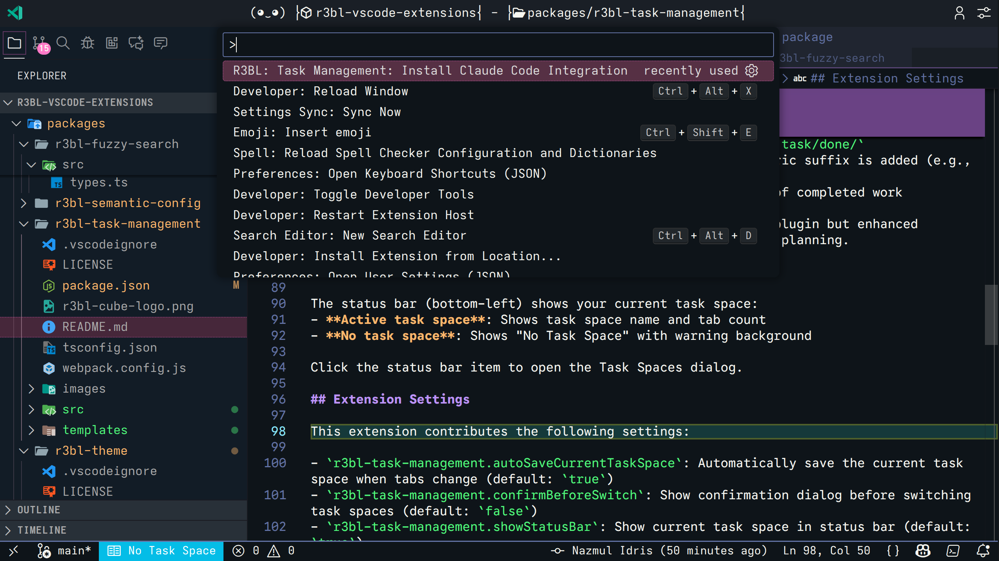
_Command palette → "R3BL Task Management: Install Coding Agent Integration"_

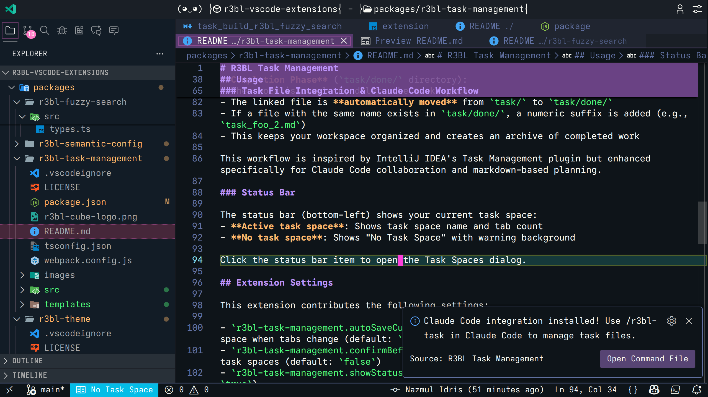
_Creates .agent/commands, .gemini/commands, or .claude/commands if needed_

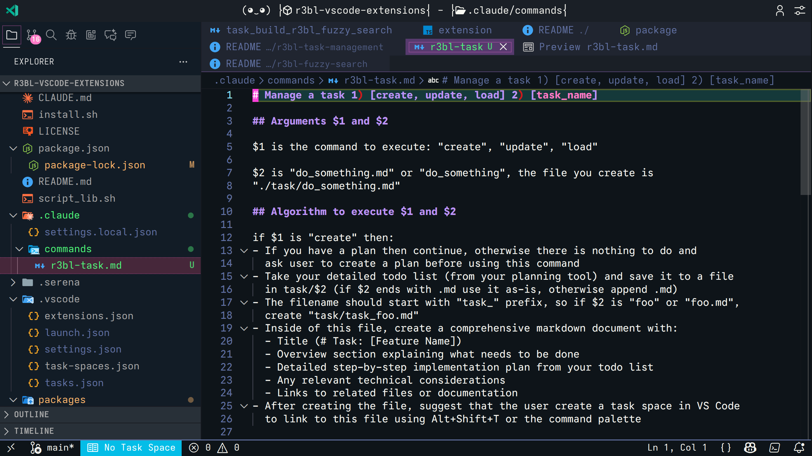
_Installs `/r3bl-task` slash command_

This installs the `/r3bl-task` command for your Coding Agent (Claude Code, Gemini CLI,
etc.):

- `/r3bl-task create [name]` - Create task file from your todo list
- `/r3bl-task update [name]` - Update progress
- `/r3bl-task load [name]` - Resume work on a task

The extension supports the following directories for custom commands (in priority order):

1. `.gemini/commands`
2. `.claude/commands`
3. `.agent/commands`

If none of these exist, you'll be prompted to choose which one to create.

**Automatic Updates**

The extension automatically keeps the `/r3bl-task` command up-to-date:

- When the extension is updated with command improvements, your local command file is
  automatically upgraded
- Uses SHA256 checksum comparison to detect changes
- No permission prompt needed (file is expected to be in git for review)
- You'll see a brief notification: "R3BL Task command updated"
- Review changes with `git diff .agent/commands/r3bl-task.md` (or your chosen directory)
  before committing
- Revert if needed: `git checkout .agent/commands/r3bl-task.md`

This ensures you always have the latest command features without manual intervention.

#### Create Task Space from Task File

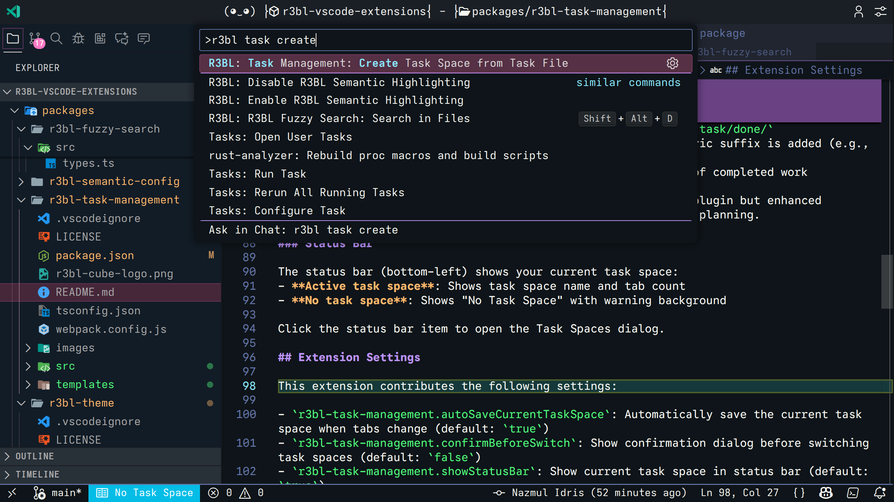
_Command palette → "Create Task Space from Task File"_

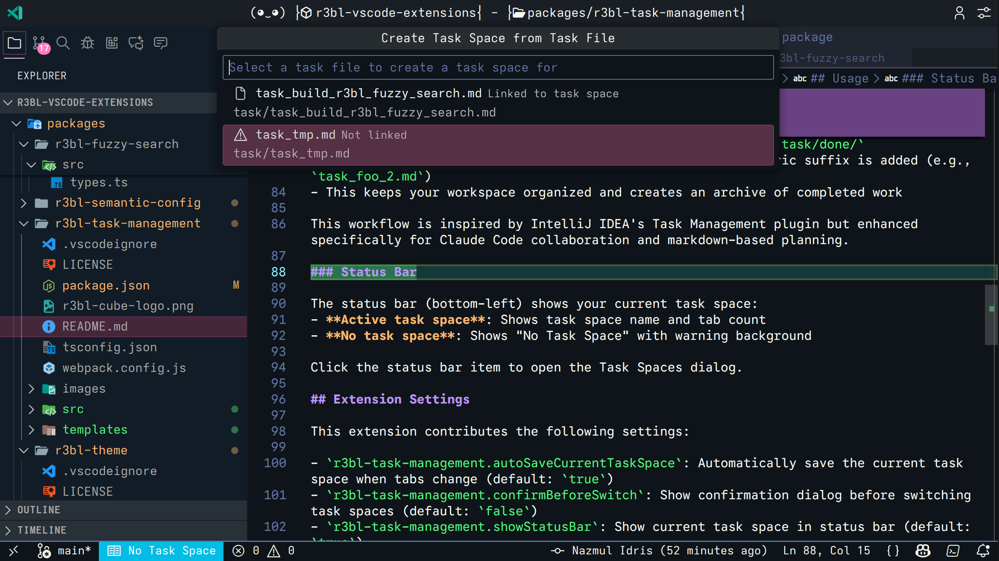
_Shows all task/_.md files (⚠️ = not linked)\*

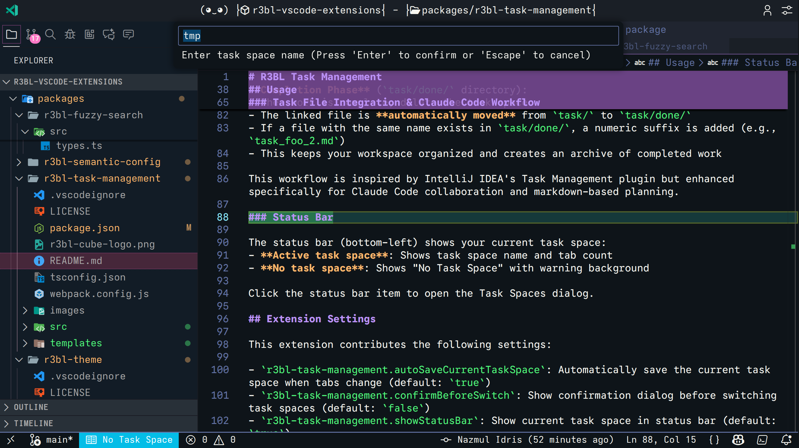
_Pre-fills name from filename_

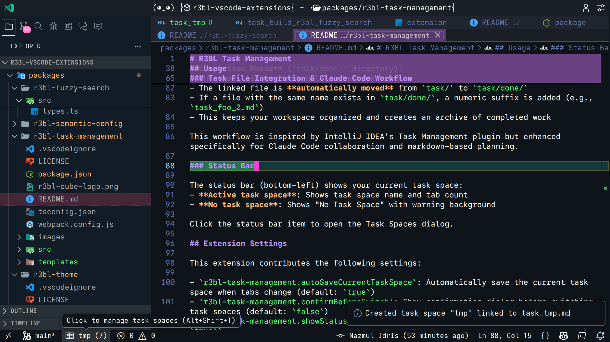
_Ready to use!_

#### Smart Prompting

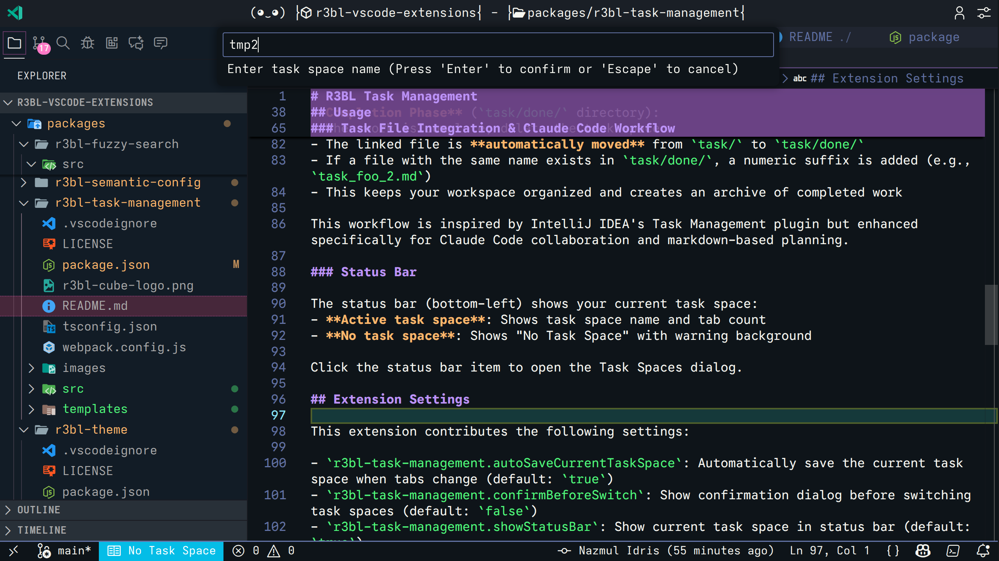
_Creating task space with linked file..._

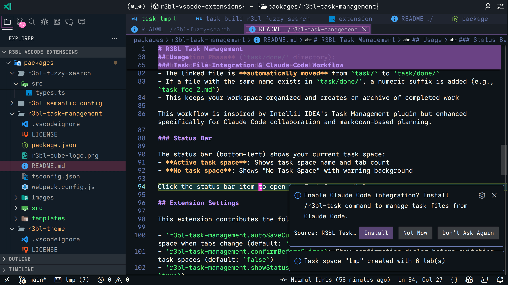
_...prompts to install Coding Agent integration (with "Don't Ask Again" option)_

### Power User: Multiple Coding Agent Instances

Run **multiple Coding Agent instances in parallel** (e.g., Claude Code, Gemini CLI in
terminal tabs or tmux panes), each working on different tasks, coordinated through one VS
Code instance:

1. **Terminal 1**: `claude` → `/r3bl-task create feature_a` → Creates `task/feature_a.md`
2. **Terminal 2**: `claude` → `/r3bl-task create feature_b` → Creates `task/feature_b.md`
3. **VS Code**: Auto-picked up in **Available Task Spaces** (`Alt+Shift+T`)
4. **Switch & Review**: `Alt+Shift+T` to switch between tasks—each keeping its own spatial
   context (opened tabs and `Alt+U` jump points)!

True parallel development on the same branch!

## Important: How It Works

### Task Spaces Are WITHIN One Branch

**This extension helps you manage multiple workflows WITHIN a single git branch.** It does
not manage separate git feature branches. When you switch git branches, your task spaces
and jump points reflect what's in `.vscode/task-spaces.json` and
`.vscode/jump-points.json` in your workspace.

### Filesystem-Based Memory

Task spaces and per-task jump points are stored in `.vscode/task-spaces.json` and
`.vscode/jump-points.json` in your workspace. **The extension's memory is tied to the
filesystem, not global VS Code state.**

This means:

- Task spaces and jump points are **per-workspace** (different projects stay completely
  isolated)
- They remain consistent across branch switches when ignored in `.gitignore` (recommended)

### Should You Commit `.vscode/task-spaces.json` & `.vscode/jump-points.json`?

#### ✅ Recommended: Add to `.gitignore`

```bash
echo ".vscode/task-spaces.json" >> .gitignore
echo ".vscode/jump-points.json" >> .gitignore
```

**This extension is designed for personal workflow management.** Task spaces and jump
points help YOU organize YOUR work - which files are open and where you drilled into
definitions for implementation vs research vs code review. This is personal context, not
project configuration.

**With gitignore:**

- ✅ Task spaces and jump points are yours alone
- ✅ Branch switching doesn't overwrite your spaces or trails
- ✅ No merge conflicts
- ✅ Your workflow stays consistent across branches

**Example:** You're on `feature/auth` with task spaces "Implementation", "Research",
"Testing". You `git checkout main` to check something - your task spaces and jump points
stay exactly the same. Switch back to `feature/auth` - everything's still there.

#### Alternative: Commit It (Team Collaboration)

**Only do this if** you want to share task spaces with your team (e.g., "here are the
relevant files for this feature").

**Note:** The extension automatically detects when the files change (e.g., branch switch)
and reloads state accordingly. This makes committing _possible_, but it's still not the
recommended workflow for most users.

**Be aware:**

- ⚠️ Different branches will have different task spaces
- ⚠️ **Merge conflicts are inevitable** - Each team member has their own task space data
  in the JSON files. When multiple people commit changes to the same file, git will
  constantly show merge conflicts
- ⚠️ Team members' personal workflows differ (your "Implementation" space has different
  files than theirs)

## Reference

### Commands

- `R3BL Task Management: Manage Task Spaces` - Open Dashboard (Alt+Shift+T)
- `R3BL Task Management: Finish Current Task` - Archive current, prune its jump points,
  and pop back to stacked parent or close to No Task Space (Alt+Shift+F)
- `R3BL Task Management: Pop Task from Stack` - Pop active stack head to parent, or resume
  stack head when browsing/off-stack, or close to No Task Space if empty (Alt+Shift+J)
- `R3BL Task Management: Push Task onto Stack...` - Push onto Task Stack and switch to a
  chosen target task or clean new subtask
- `R3BL Task Management: Close Current Task Space` - Save and close active task space
  (Alt+Shift+C)
- `R3BL Task Management: Move Current Task to Backlog` - Relegate to task/pending/
- `R3BL Task Management: Install Coding Agent Integration` - Install /r3bl-task command
- `R3BL Task Management: Create Task Space from Task File` - Create from existing task
  file
- `R3BL: Jump to Definition and Record Jump Point` - Record task-scoped jump point and
  jump to definition (Alt+U)
- `R3BL: Show Jump Points` - Open Jump Point Navigation popup for the active task space
  (Alt+Shift+U)

### Keyboard Shortcuts

| Shortcut      | Command ID                                   | When            |
| ------------- | -------------------------------------------- | --------------- |
| `Alt+Shift+T` | `r3bl-task-management.showTaskSpaces`        | Not in terminal |
| `Alt+Shift+F` | `r3bl-task-management.finishCurrentTask`     | Not in terminal |
| `Alt+Shift+J` | `r3bl-task-management.popTaskSpace`          | Not in terminal |
| `Alt+Shift+C` | `r3bl-task-management.closeCurrentTaskSpace` | Not in terminal |
| `Alt+U`       | `r3bl-task-management.jumpAndRecord`         | Editor focus    |
| `Alt+Shift+U` | `r3bl-task-management.showJumpPoints`        | Global          |

You can customize these shortcuts in VS Code's Keyboard Shortcuts settings by searching
for the command IDs above.

### Extension Settings

- `r3bl-task-management.autoSaveCurrentTaskSpace` - Auto-save on tab changes (default:
  `true`). Disable for "view-only" mode where this instance syncs from others but doesn't
  write back.
- `r3bl-task-management.autoSaveDebounceMs` - Delay in milliseconds before auto-saving
  after tab changes (default: `500`, range: 100-5000). Lower values save faster but may
  cause more disk writes.
- `r3bl-task-management.confirmBeforeSwitch` - Confirm before switching (default: `false`)
- `r3bl-task-management.showStatusBar` - Show status bar item (default: `true`)
- `r3bl-task-management.restoreTabsOnStartup` - Restore tabs from active task space when
  VS Code starts (default: `true`)

### Status Bar

Bottom-left corner shows:

- **On-stack active task**: `$(layers) Feature: Auth (5) [stack: N]` (where `N` is the
  number of paused callers beneath the active head)
- **Browsing a stack frame**: `$(layers) Caller Task (3) [in stack · head: <Head>]` so you
  can return to `<Head>` anytime with `Alt+Shift+J` without popping
- **Off-stack active task (or No Task Space) with a parked stack**: Shows
  `[parked: <Head>]` so you can jump back to the stack head anytime with `Alt+Shift+J`
- **No task space**: `No Task Space` with warning background

Click to open Task Spaces dialog.

### File Format

State is split across **shared workspace JSON files** (synced across IDEs) and
**per-instance VSCode workspace state** (avoiding git/focus collisions):

#### `.vscode/task-spaces.json` (Shared Workspace Task Spaces & Stack)

Synced across all editor instances opening the same project:

```json
{
    "version": "6.0",
    "taskSpaces": [
        {
            "name": "Feature: Authentication",
            "id": "uuid",
            "tabs": [
                { "path": "src/auth.ts", "isPinned": true },
                { "path": "src/login.ts", "isPinned": false }
            ],
            "taskFile": "task/authentication.md",
            "activeTab": "src/auth.ts",
            "createdAt": 1234567890
        }
    ],
    "taskSpaceStackIds": ["uuid-caller", "uuid-head"]
}
```

#### `.vscode/jump-points.json` (Shared Per-Task Jump Point Navigation)

Stores each task space's isolated Jump Point Navigation state (`v3.0`) and syncs live
across editor instances:

```json
{
    "version": "3.0",
    "tasks": {
        "uuid": {
            "currentIndex": 1,
            "points": [
                {
                    "id": "1731700000000-abc123",
                    "uriString": "file:///workspace/src/auth.ts",
                    "fsPath": "/workspace/src/auth.ts",
                    "relativePath": "src/auth.ts",
                    "line": 41,
                    "character": 11,
                    "symbolLabel": "fn verify_token",
                    "linePreview": "pub fn verify_token(token: &str) -> Result<Claims>"
                }
            ]
        }
    }
}
```

#### VSCode Workspace State (Per-Instance)

Per-instance data is stored in VSCode's workspace state. This data is NOT shared between
VSCode windows, allowing different windows to have different task spaces active
simultaneously.

**Storage Location:**

- Linux: `~/.config/Code/User/workspaceStorage/<workspace-id>/state.vscode.*`
- macOS:
  `~/Library/Application Support/Code/User/workspaceStorage/<workspace-id>/state.vscode.*`
- Windows: `%APPDATA%\Code\User\workspaceStorage\<workspace-id>\state.vscode.*`

**Data Format:**

```json
{
    "activeTaskSpaceId": "uuid",
    "taskSpaceMetadata": {
        "uuid-1": { "lastAccessed": 1234567890 },
        "uuid-2": { "lastAccessed": 1234555555 }
    }
}
```

**Note:** This metadata is automatically cleaned up when task spaces are deleted,
preventing any memory leaks or storage bloat.

#### Multi-Instance Behavior

| Data                 | Synced? | Notes                                                          |
| -------------------- | ------- | -------------------------------------------------------------- |
| Task space list      | ✅ Yes  | Creating/deleting/renaming syncs across all windows            |
| Tab content          | ✅ Yes  | Adding/removing files from a space syncs                       |
| Task Stack           | ✅ Yes  | Workspace-wide call stack (`taskSpaceStackIds`) syncs          |
| Per-task Jump Points | ✅ Yes  | `.vscode/jump-points.json` syncs jump points per task space ID |
| Active task space    | ❌ No   | Each window has its own **Active Task** pointer                |
| Last accessed        | ❌ No   | Each window tracks its own usage history                       |

**Example use case:** Open the same project in VS Code and Antigravity IDE, with different
task spaces active in each window. Both windows stay in sync for task space definitions,
the workspace Task Stack, and per-task Jump Points, while each maintains its own active
focus.

**Storage Benefits:**

- ✅ Task space definitions remain clean and git-friendly
- ✅ No git noise from frequent timestamp/active space updates
- ✅ Multiple VSCode windows can work on different task spaces simultaneously
- ✅ "Last accessed" sorting still works perfectly per-instance
- ✅ Automatic cleanup when task spaces are deleted (no memory leaks)

**Note:** `.vscode/task-spaces.json` automatically migrates `v1.0 → v6.0` and
`.vscode/jump-points.json` automatically migrates `v1.0 / v2.0 → v3.0` on load.

### When Do Files Get Saved?

The shared JSON files are automatically saved to disk in these situations:

1. **Create task space** - Saves the new task space with cloned current tabs (or
   subtask-only tab when using Push New Subtask)
2. **Delete / Finish task space** - Saves after removing the space, archives the task
   file, and prunes its jump points from `.vscode/jump-points.json`
3. **Switch to task space** - Saves outgoing tabs (Active pointer stored in
   `workspaceState`)
4. **Stack Push / Pop** - Saves when pushing a task onto `taskSpaceStackIds` or popping a
   head task off the Task Stack
5. **Record / Remove Jump Points** - Saves `.vscode/jump-points.json` when recording
   (`Alt+U`), navigating (`Alt+Shift+U`), or clearing jump points
6. **Auto-save tabs** - Saves current open tabs (500ms after tab changes)

**Note:** The `lastAccessed` timestamp is updated separately in VSCode workspace state and
does NOT trigger file saves, keeping git history clean.

**Note on missing files:** When auto-save runs, it saves only the tabs that are currently
open. If a file was in your task space but failed to open (e.g., missing on current
branch), it won't be in the "currently open tabs" list and will be automatically removed
from the task space on the next save. This keeps task spaces clean and accurate to your
actual workspace.

## Shared Infrastructure

This extension uses the **R3BL Shared** extension for centralized services across all R3BL
extensions (message queuing, global configuration, and more).

See the
[R3BL Shared documentation](https://marketplace.visualstudio.com/items?itemName=R3BL.r3bl-shared)
for available services, API usage, and configuration options.

## Release Notes

See
[CHANGELOG.md](https://github.com/r3bl-org/r3bl-vscode-extensions/blob/main/CHANGELOG.md)
for detailed release notes and version history.

## License

MIT

## Contributing

Found a bug or have a feature request? Please open an issue at:
https://github.com/r3bl-org/r3bl-vscode-extensions/issues

---

**Stay organized and productive!**
