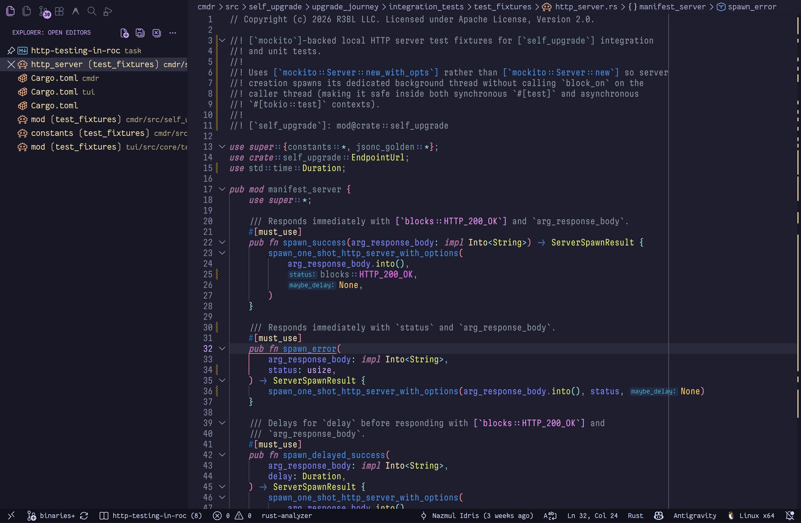
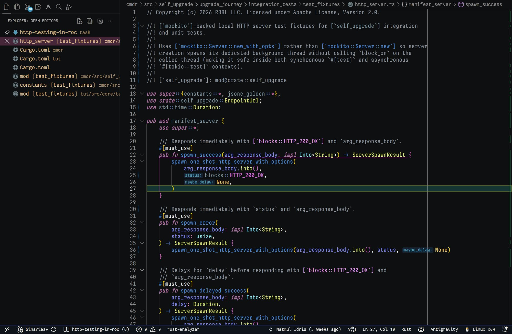
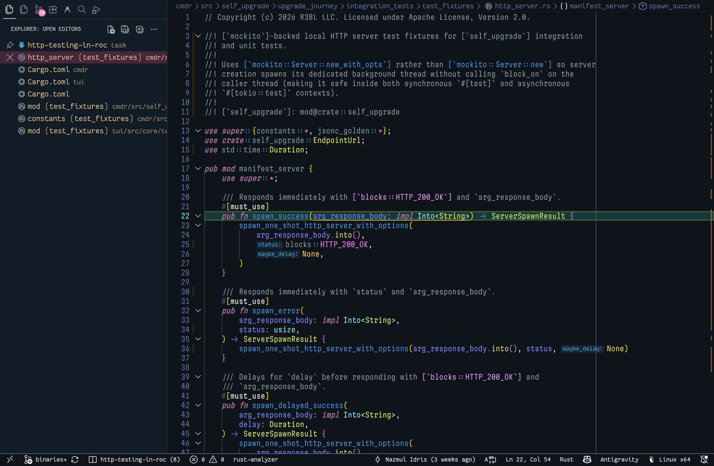

# R3BL Themes

[](https://open-vsx.org/extension/R3BL/r3bl-theme)
[](https://marketplace.visualstudio.com/items?itemName=R3BL.r3bl-theme)

A suite of carefully crafted dark themes for VS Code—**R3BL Theme**, **R3BL 2026 Theme**,
and **R3BL 2027 Theme** (each available in both standard italic and **No Italic**
variants), plus the bundled **R3BL 2027 Icons** file icon theme—optimized for Rust and
Markdown development with enhanced readability and visual appeal.

### Available Themes & Icons

1. **R3BL Theme** — Classic dark theme with italic styling for emphasis, markdown quotes,
   and semantic keywords/references.
2. **R3BL Theme (No Italic)** — Clean non-italic variant of the classic theme for
   developers who prefer straight typography.
3. **R3BL 2026 Theme** — Modernized 2026 dark palette with deep `#0e0f10` editor and
   sidebar background and italic styling.
4. **R3BL 2026 Theme (No Italic)** — Modernized 2026 dark palette with deep `#0e0f10`
   editor and sidebar background and non-italic typography.
5. **R3BL 2027 Theme** — Combines Catppuccin Mocha (workbench colors, TextMate grammar,
   and Neovim rainbow bracket colors) with R3BL semantic token rules, pill-tinted inlay
   hints, and ErrorLens diagnostic foregrounds.
6. **R3BL 2027 Theme (No Italic)** — Non-italic variant of R3BL 2027 Theme with straight
   typography across all syntax and semantic tokens.
7. **R3BL 2027 Icons** _(File Icon Theme)_ — Self-contained file and folder icon theme
   (from Catppuccin Icons) bundled directly inside `r3bl-theme` (automatically activated
   when selecting `R3BL 2027 Theme` or `R3BL 2027 Theme (No Italic)`).

## Features

- **Bundled File Icon Theme**: Selecting `R3BL 2027 Theme` (or its `No Italic` variant)
  automatically switches your file icon theme to **R3BL 2027 Icons**
- **Selectable Comment Brightness**: Choose between 3 comment brightness levels (`dim`,
  `medium`, `bright`) across all 6 themes via `R3BL: Set Comment Brightness...` (defaults
  to soft slate gray `dim` out of the box)
- **Pill-Tinted Inlay Hints & ErrorLens Colors**: Consistent, easy-to-scan inlay hint
  pills and ErrorLens diagnostic foregrounds across every R3BL theme
- **Rust-Optimized Colors**: Specially designed syntax highlighting for Rust code with
  distinct colors for keywords, types, functions, and macros
- **Italic & Non-Italic Variants**: Choose the typography style that fits your workflow
  and font preferences
- **Dark Theme Excellence**: Professional dark color scheme that reduces eye strain during
  long coding sessions
- **Rich Markdown Support**: Beautiful rendering of documentation comments and markdown
  tables
- **Semantic Highlighting**: Automatically installs
  [R3BL Semantic Configuration](https://marketplace.visualstudio.com/items?itemName=R3BL.r3bl-semantic-config)
  for enhanced Rust highlighting
- **Consistent UI**: Carefully selected colors for sidebar, tabs, status bar, and
  terminals
- **Bracket Pair Colorization**: Clear visual distinction for nested code blocks
- **Selection & Search**: High-contrast selection and search highlighting

## Screenshots

All three themes are shown below on the same Rust file for direct visual comparison. Each
theme also includes a matching **`(No Italic)`** variant (`R3BL 2027 Theme (No Italic)`,
`R3BL 2026 Theme (No Italic)`, and `R3BL Theme (No Italic)`) with identical colors and
straight, non-italic typography.

### R3BL 2027 Theme


_Catppuccin Mocha workbench (`#1e1e2e` / `#181825`), bundled **R3BL 2027 Icons**, rainbow
bracket guides, R3BL semantic tokens, and pill-tinted inlay hints. Also available as
`R3BL 2027 Theme (No Italic)`._

### R3BL 2026 Theme


_Modernized 2026 dark palette with deep `#0e0f10` editor and sidebar background, R3BL
semantic tokens, and pill-tinted inlay hints. Also available as
`R3BL 2026 Theme (No Italic)`._

### R3BL Theme


_Classic R3BL dark palette (`#0e1419` editor / `#121c26` sidebar) with R3BL semantic
tokens and pill-tinted inlay hints. Also available as `R3BL Theme (No Italic)`._

## Installation

### From Extension Pack (Recommended)

Install the
[R3BL Extension Pack](https://marketplace.visualstudio.com/items?itemName=R3BL.r3bl-extension-pack)
which includes this theme along with other R3BL tools.

### Standalone Installation

1. Open VS Code
2. Press `Ctrl+P` (or `Cmd+P` on macOS)
3. Type: `ext install R3BL.r3bl-theme`
4. Press Enter

### From VSIX File

```bash
code --install-extension r3bl-theme-x.x.x.vsix
```

## Usage

### Activate the Theme

1. Open Command Palette (`Ctrl+Shift+P` or `Cmd+Shift+P`)
2. Type "Color Theme"
3. Select "Preferences: Color Theme"
4. Choose any of the 6 R3BL themes:
    - `R3BL Theme`
    - `R3BL Theme (No Italic)`
    - `R3BL 2026 Theme`
    - `R3BL 2026 Theme (No Italic)`
    - `R3BL 2027 Theme`
    - `R3BL 2027 Theme (No Italic)`

**Or use the keyboard shortcut:**

- Press `Ctrl+K Ctrl+T` (or `Cmd+K Cmd+T` on macOS)
- Select your preferred R3BL theme variant

### File Icon Theme (`R3BL 2027 Icons`)

When you select `R3BL 2027 Theme` or `R3BL 2027 Theme (No Italic)`, the companion
`r3bl-semantic-config` extension automatically switches `workbench.iconTheme` to **R3BL
2027 Icons** (`r3bl-2027-icons`). If you later switch to another color theme, your active
icon theme is left untouched. You can also select **R3BL 2027 Icons** manually at any time
via `Preferences: File Icon Theme`.

### Enhanced Semantic Highlighting

This theme **automatically installs** the R3BL Semantic Configuration extension, which
provides enhanced semantic highlighting specifically designed to complement this theme's
color palette.

The semantic configuration extension:

- Automatically detects when any of the R3BL themes is active
- Dynamically applies matching semantic highlighting (italic rules for standard themes,
  non-italic rules for No Italic variants)
- Can be enabled/disabled via commands: `R3BL: Enable/Disable Semantic Highlighting`

**No additional setup required** - just activate any of the R3BL themes and enjoy enhanced
syntax highlighting!

### Color Palette

The themes use a carefully selected color palette:

| Element       | Color                  | Usage                                        |
| ------------- | ---------------------- | -------------------------------------------- |
| **Keywords**  | Purple (`#c586c0`)     | `fn`, `let`, `mut`, `pub`, etc.              |
| **Types**     | Teal (`#4ec9b0`)       | Struct names, type parameters                |
| **Functions** | Yellow (`#dcdcaa`)     | Function names and calls                     |
| **Strings**   | Orange (`#ce9178`)     | String literals                              |
| **Numbers**   | Green (`#b5cea8`)      | Numeric literals                             |
| **Comments**  | Slate Gray (`#8B949E`) | Single and multi-line comments (dim default) |
| **Macros**    | Cyan (`#4fc1ff`)       | Rust macros like `println!`                  |

### Comment Brightness Levels

All 6 R3BL themes support 3 comment brightness levels managed dynamically via the
companion
[R3BL Semantic Configuration](https://marketplace.visualstudio.com/items?itemName=R3BL.r3bl-semantic-config)
extension:

| Level                 | Color     | Description                               |
| :-------------------- | :-------- | :---------------------------------------- |
| **`dim`** _(Default)_ | `#8B949E` | Cool slate gray for maximum eye comfort   |
| **`medium`**          | `#ABACAC` | Neutral silver gray for balanced contrast |
| **`bright`**          | `#E8DCF4` | Vibrant lavender for high contrast        |

To change brightness at any time:

1. Open the Command Palette (`Ctrl+Shift+P` / `Cmd+Shift+P`).
2. Run `R3BL: Set Comment Brightness...`.
3. Choose **Dim**, **Medium**, or **Bright**.

Or set `"r3bl.commentBrightness": "dim"` in your `settings.json`.

### Recommended Settings

For the best experience (especially with rainbow brackets and active bracket guides in
`R3BL 2027 Theme`):

```json
{
    "editor.semanticHighlighting.enabled": true,
    "editor.bracketPairColorization.enabled": true,
    "editor.bracketPairColorization.independentColorPoolPerBracketType": true,
    "editor.guides.bracketPairs": "active",
    "workbench.colorTheme": "R3BL 2027 Theme"
}
```

## Optimized For

### Primary Languages

- **Rust** - Enhanced syntax highlighting for keywords, types, macros, and test functions
- **Markdown** - Beautiful rendering of documentation and README files

### Also Works Great With

- TypeScript/JavaScript
- Python
- Go
- JSON/YAML
- Shell scripts
- And more!

## What Makes It Different

### Rust-First Design

Unlike generic themes, R3BL themes are built specifically for Rust developers:

- Distinct colors for `pub`, `fn`, `impl`, `trait`, and other Rust keywords
- Clear visual distinction between owned types, references, and lifetimes
- Macro highlighting that stands out
- Test function backgrounds for easy test identification

### Semantic Awareness

Works with VS Code's semantic highlighting to provide context-aware colors based on the
language server's understanding of your code, not just regex patterns.

### Eye Comfort

- Carefully calibrated contrast ratios
- No harsh whites or overly bright colors
- Consistent darkness across all UI elements
- Reduced blue light in the color palette

## Comparison with Other Themes

| Feature              | R3BL Theme       | Generic Dark Themes |
| -------------------- | ---------------- | ------------------- |
| Rust Optimization    | ✅ Purpose-built | ❌ Generic patterns |
| Semantic Support     | ✅ Full support  | ⚠️ Varies           |
| Markdown in Comments | ✅ Rendered      | ⚠️ Basic            |
| Eye Comfort          | ✅ Optimized     | ⚠️ Varies           |

## Customization

Want to tweak the themes? Add to your `settings.json`:

```json
{
    "workbench.colorCustomizations": {
        "[R3BL Theme]": {
            "editor.background": "#1e1e1e",
            "editor.foreground": "#d4d4d4"
        },
        "[R3BL Theme (No Italic)]": {
            "editor.background": "#1e1e1e",
            "editor.foreground": "#d4d4d4"
        },
        "[R3BL 2026 Theme]": {
            "editor.background": "#1e1e1e",
            "editor.foreground": "#d4d4d4"
        },
        "[R3BL 2026 Theme (No Italic)]": {
            "editor.background": "#1e1e1e",
            "editor.foreground": "#d4d4d4"
        },
        "[R3BL 2027 Theme]": {
            "editor.background": "#1e1e1e",
            "editor.foreground": "#d4d4d4"
        },
        "[R3BL 2027 Theme (No Italic)]": {
            "editor.background": "#1e1e1e",
            "editor.foreground": "#d4d4d4"
        }
    },
    "editor.tokenColorCustomizations": {
        "[R3BL Theme]": {
            "textMateRules": [
                {
                    "scope": "keyword.control.rust",
                    "settings": {
                        "foreground": "#YOUR_COLOR"
                    }
                }
            ]
        },
        "[R3BL Theme (No Italic)]": {
            "textMateRules": [
                {
                    "scope": "keyword.control.rust",
                    "settings": {
                        "foreground": "#YOUR_COLOR"
                    }
                }
            ]
        },
        "[R3BL 2026 Theme]": {
            "textMateRules": [
                {
                    "scope": "keyword.control.rust",
                    "settings": {
                        "foreground": "#YOUR_COLOR"
                    }
                }
            ]
        },
        "[R3BL 2026 Theme (No Italic)]": {
            "textMateRules": [
                {
                    "scope": "keyword.control.rust",
                    "settings": {
                        "foreground": "#YOUR_COLOR"
                    }
                }
            ]
        },
        "[R3BL 2027 Theme]": {
            "textMateRules": [
                {
                    "scope": "keyword.control.rust",
                    "settings": {
                        "foreground": "#YOUR_COLOR"
                    }
                }
            ]
        },
        "[R3BL 2027 Theme (No Italic)]": {
            "textMateRules": [
                {
                    "scope": "keyword.control.rust",
                    "settings": {
                        "foreground": "#YOUR_COLOR"
                    }
                }
            ]
        }
    }
}
```

## Release Notes

See
[CHANGELOG.md](https://github.com/r3bl-org/r3bl-vscode-extensions/blob/main/CHANGELOG.md)
for detailed release notes and version history.

## License & Attribution

MIT — see [LICENSE](LICENSE) for full details.

- **R3BL 2027 Theme** incorporates workbench, bracket, and TextMate palette definitions
  derived from [Catppuccin for VSCode](https://github.com/catppuccin/vscode) (MIT License,
  Copyright (c) 2021 Catppuccin).
- **R3BL 2027 Icons** incorporates icon assets and definitions from
  [Catppuccin Icons for VSCode](https://github.com/catppuccin/vscode-icons) (MIT License,
  Copyright (c) 2023 Catppuccin, Copyright (c) 2023 thang-nm).

## Contributing

Found a color that doesn't look quite right? Have a suggestion for improvement? Please
open an issue at: https://github.com/r3bl-org/r3bl-vscode-extensions/issues

---

**Code in color, code in style!**
